# База знань STsup: Повний практичний посібник та бізнес-архітектура системи

> **Призначення документа**: Офіційне навчальне джерело (Source Document) для імпорту в **Google NotebookLM**, платформи корпоративного онбордингу, створення подкастів «Audio Overview», скриптів відеоуроків та інтерактивного Q&A для технічних фахівців, клієнтів і керівників проєктів.
> **Версія системи**: STsup Core Engine v0.4.4+  
> **Мова документації**: Українська (ДСТУ/IT-стандарт)  
> **Статус документа**: Затверджено до релізу та навчання

---

## 0. Термінологічний словник та концептуальна модель (Glossary)

Для уникнення неоднозначностей при обробці мовними моделями в NotebookLM наведено точні канонічні визначення компонентів:

* **STsup (Service & Task Support System)** — єдина гібридна платформа, що поєднує функціонал корпоративного Jira-подібного трекера завдань та Service Desk для зовнішніх замовників.
* **Канонічний URL (`/browse/{PROJECT_KEY}-{NUMBER}`)** — фіксована адреса ресурсу, що однозначно ідентифікує завдання за кодом проєкту та його порядковим номером (наприклад, `/browse/RIGA-2`).
* **Глобальний контекст (`/projects/all`)** — робочий простір для адміністраторів та інженерів, де консолідуються завдання з усіх існуючих організацій та проєктів одночасно.
* **Клієнтський портал (`/portal`)** — ізольований вебінтерфейс для користувачів із роллю `CLIENT`, який обмежує доступ лише даними їхньої власної організації та приховує внутрішні технічні атрибути (робочі журнали інженерів, беклог, системні налаштування).
* **Work Tracking (Облік часу)** — механізм фіксації первинної оцінки (Original Estimate), фактично витраченого часу (Logged Time) та автоматичного перерахунку залишку (Remaining Time) на основі алгоритму з динамічним розширенням залишку при перевитратах.
* **«Повернути до клієнта» (Return to Client)** — атомарна бізнес-дія інженера, яка переводить тікет у статус `AWAITING_CLIENT` та одночасно робить виконавцем (Assignee) автора звернення (Reporter).
* **«Повернути в підтримку» (Return to Support)** — зустрічна бізнес-дія клієнта з порталу, яка переводить тікет у статус `IN_PROGRESS` та повертає завдання до черги інженерів.
* **Крос-проєктний Kanban (`/boards`)** — візуальна дошка перетягування карток (Drag-and-Drop) за 4 ключовими колонками життєвого циклу завдань (`BACKLOG`, `IN_PROGRESS`, `TESTING`, `DONE`).
* **Реєстр беклогу проєкту (`?section=backlog`)** — ізольований табличний перелік завдань проєкту, які знаходяться виключно у початковому статусі `BACKLOG` та очікують планування.
* **Пакет резервної копії (`.stsup`)** — стиснений архів (Gzip), що містить повний реляційний дамп бази даних, конфігурації, журнали аудиту та файлові вкладення.

---

## МОДУЛЬ 1. Загальна архітектура, авторизація та глобальна навігація

### 1.1. Авторизація та поведінка стартового екрана

Система STsup забезпечує рольову диференціацію на рівні точки входу. Після успішної аутентифікації сесії клієнтський маршрутизатор визначає роль користувача та виконує детерміновану переадресацію.

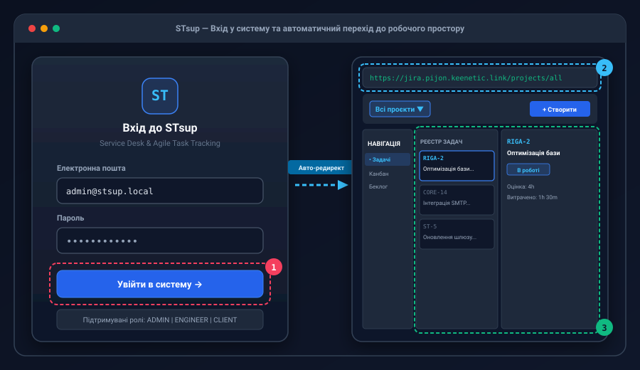

#### Покроковий сценарій входу (Крок за кроком)
1. **Крок 1**: Користувач переходить на кореневий маршрут `https://<домен>/auth/login`.
2. **Крок 2**: Вводить адресу корпоративної електронної пошти та пароль у форму авторизації ❶.
3. **Крок 3**: Натискає кнопку «Увійти в систему». Серверний обробник перевіряє хеш пароля, генерує безпечну HTTP-Only сесійну куку (Session Cookie) та повертає об'єкт користувача з полем `role`.
4. **Крок 4**: **Автоматична маршрутизація**:
   * Для ролей `ADMIN` (Адміністратор) та `ENGINEER` (Інженер) спрацьовує перенаправлення на `/projects/all` ❷. Інженер одразу бачить зведений пул завдань у розрізі всіх доступних контрактів.
   * Для ролі `CLIENT` (Замовник) автоматично викликається перенаправлення на захищений клієнтський хаб `/portal`. Клієнту суворо заблоковано доступ до загальних реєстрів інженерів.

---

### 1.2. Верхня навігаційна панель (Navbar) та перемикання контекстів

Верхня панель STsup слугує командним центром для оперативного управління завданнями без втрати фокусу.

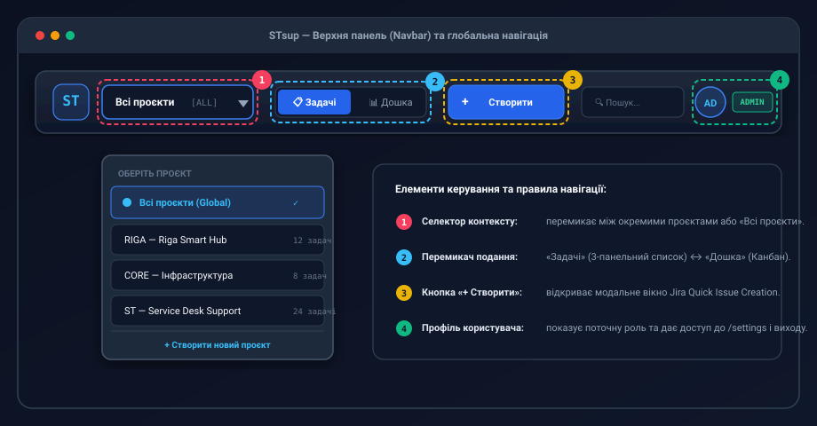

#### Складові елементи панелі:
* **Логотип та глобальний перемикач (Лівіше)** ❶:
  * Dropdown «Проєкти»: дозволяє обрати режим **«Усі проєкти» (`/projects/all`)** або перейти до окремого ізольованого проєкту (наприклад, **RIGA — Riga Mall Support**).
  * Меню навігації по розділах: «Реєстр задач», «Kanban-дошка» (`/boards`), «Клієнтський портал» (`/portal`).
* **Пошукова панель та швидке створення (Центр та праворуч)** ❷:
  * Пошуковий рядок із комбінацією клавіш `Ctrl + K` / `Cmd + K` для миттєвого пошуку задач за ключем або текстом.
  * Акцентна синя кнопка **«+ Створити задачу»**: викликає модальне вікно створення завдання з будь-якого екрана системи.
* **Профіль та статус користувача (Правий край)** ❸:
  * Відображення аватара, імені, ролі (`ADMIN`, `ENGINEER`, `CLIENT`) та швидкого переходу до налаштувань системи (`/settings`).

---

### 1.3. Уніфікована маршрутизація та прямі канонічні URL (/browse)

В системі STsup впроваджено уніфікований стандарт адресації завдань за аналогією з галузевим еталоном Jira:

$$\text{URL} = \text{https://}\langle\text{domain}\rangle\text{/browse/}\{\text{PROJECT\_KEY}\}\text{-}\{\text{ISSUE\_NUMBER}\}$$

Наприклад: `https://jira.company.com/browse/RIGA-2`.

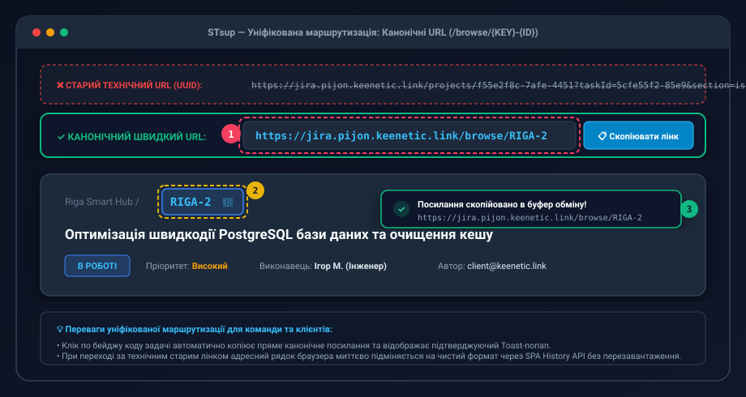

#### Алгоритм роботи клієнтського роутера (SPA History API):
1. **Відкриття задачі в інтерфейсі**:
   * При кліку на картку в дошці або реєстрі роутер викликає `window.history.pushState({}, '', '/browse/RIGA-2')` ❷.
   * Адресний рядок браузера негайно синхронізується з канонічним читабельним виглядом без повного перезавантаження сторінки (SPA In-Place navigation).
2. **Копіювання посилання в 1 клік**:
   * Натискання на бейдж коду задачі (або іконку ланцюжка поруч із заголовком) копіює абсолютний канонічний лінк у буфер обміну.
   * Користувач отримує спливаюче повідомлення (Toast notification) зеленого кольору: **«Посилання скопійовано в буфер обміну»** ❶.
3. **Прямий перехід або оновлення за посиланням (Direct Landing / F5)**:
   * Якщо користувач вставляє посилання `/browse/RIGA-2` у нову вкладку браузера, серверний контролер:
     * Розбирає регулярний вираз `^([A-Z0-9]+)-(\d+)$`.
     * Знаходить проєкт за кодом `RIGA` та задачу за порядковим номером `2`.
     * Перевіряє права доступу користувача до організації даного проєкту.
     * Відкриває проєктний контекст і розгортає повну картку задачі ❸.
   * Якщо задачі з таким номером не існує — виводиться інформативна сторінка «Задачу RIGA-999 не знайдено» із кнопкою повернення до загального списку.

---

### Блок для NotebookLM: Скрипт подкасту та FAQ Модуля 1

#### 🎙 Сценарій диктора для аудіоогляду:
> **Ведучий 1**: «Уявіть, що інженер підтримки починає свій робочий день. Що він бачить першим?»  
> **Ведучий 2**: «В системі STsup інженерам та адмінам не потрібно вручну обирати окремі папки чи клієнтів. Одразу після авторизації система відкриває режим "Всі проєкти". Це єдине вікно контролю над усім пулом задач. А для клієнтів створено окремий портал, куди вони потрапляють автоматично, навіть не здогадуючись про складну внутрішню кухню інженерів.»  
> **Ведучий 1**: «А як щодо взаємодії в команді? Як скинути задачу колезі в чаті?»  
> **Ведучий 2**: «Дуже просто! Тут реалізовано стандарт канонічних посилань прямо як у Jira — формат /browse/KEY-NUMBER. Натиснули на код задачі — посилання вже в буфері, а адресний рядок браузера завжди показує красиву й зрозумілу адресу без зайвих технічних UUID-ідентифікаторів.»

#### ❓ Часті запитання (FAQ):
* **П: Що станеться, якщо клієнт спробує відкрити посилання `/projects/all`?**  
  *В: Серверний Guard та Middleware зафіксують спробу неавторизованого доступу, повернуть статус 403 Forbidden та перенаправлять клієнта на `/portal`.*
* **П: Чи зберігається відкрита картка задачі при натисканні F5?**  
  *В: Так. Завдяки підтримці серверного рендерингу за шаблоном `/browse/[key]`, після оновлення сторінки відкриється саме та задача, яку переглядав користувач.*

---

## МОДУЛЬ 2. Робота з карткою задачі (Jira-інтерфейс)

Картка задачі спроєктована за канонічною трипанельною структурою корпоративного класу, що гарантує максимальну ергономіку та високу швидкість обробки звернень.

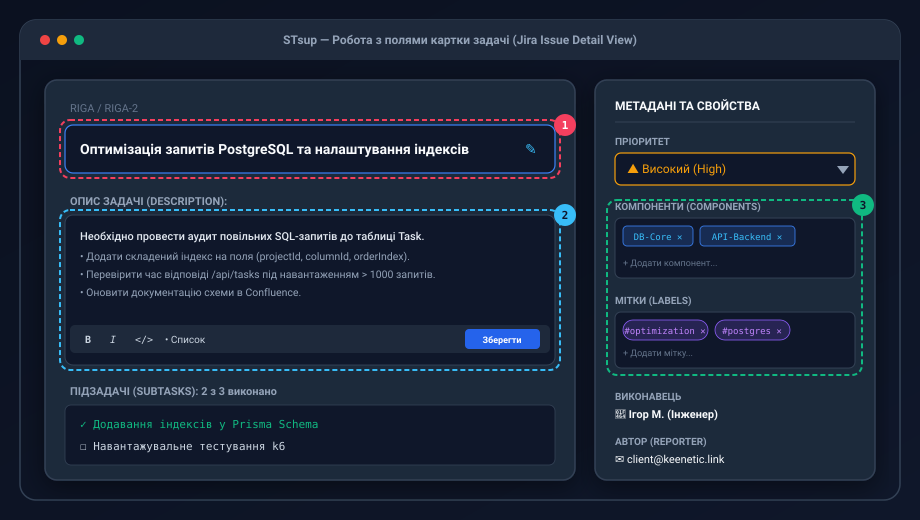

### 2.1. Анатомія робочої панелі задачі

| Зона | Елементи управління | Бізнес-правила |
| :--- | :--- | :--- |
| **Центральна область (Left/Main)** | • Заголовок (Summary) • Опис (Description) • Вкладки: Коментарі, Історія, Вкладення | Поля підтримують швидке збереження. Зміна тексту фіксується в аудит-лозі із фіксацією автора. |
| **Панель деталей (Right Sidebar)** | • Статус задачі (Dropdown Badge) • Пріоритет (Priority) • Компоненти (Components) • Мітки (Labels) • Виконавець (Assignee) • Автор (Reporter) | Зміна будь-якого атрибута одразу оновлює кеш стану без потреби натискання окремої кнопки «Зберегти форму». |
| **Облік часу (Work Tracking)** | • Первинна оцінка (Original Estimate) • Витрачений час (Logged Time) • Прогрес-бар виконання | Підтримує гнучкий формат запису `h`, `d`, `w`, `m`. |

---

### 2.2. Інтерактивний вибір статусу та кольорове кодування

У блоці «Деталі задачі» статус представлений інтерактивним випадаючим списком (Dropdown Badge). Для миттєвого візуального розпізнавання кожен статус має фіксовану палітру відповідно до міжнародного стандарту:

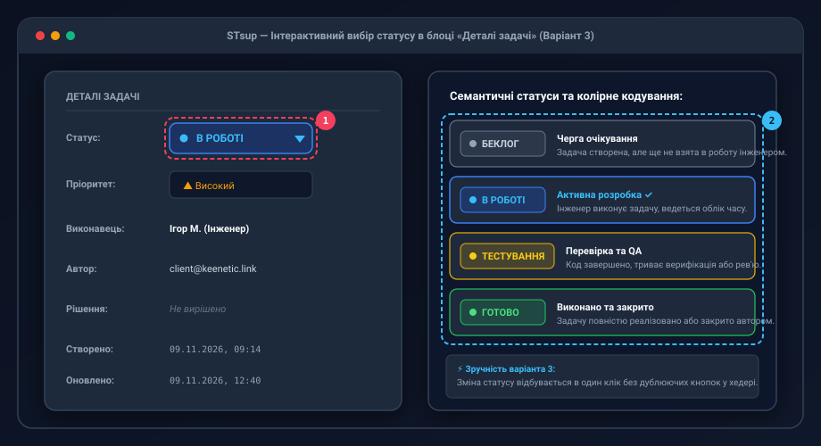

1. **`BACKLOG` (Беклог)**: Нейтральний сіро-графітовий колір (`#64748B`). Вказує, що задачу зареєстровано, але вона ще не взята до активного спринту або плану дня ❶.
2. **`IN_PROGRESS` (В роботі)**: Насичений синій колір (`#0284C7` / `#38BDF8`). Завдання знаходиться в активному опрацюванні інженером.
3. **`AWAITING_CLIENT` (Очікує клієнта)**: Попереджувальний теплий бурштиновий/помаранчевий колір (`#F59E0B`). Інженер очікує відповіді, файлів або доступу від замовника.
4. **`TESTING` (Тестування / Перевірка)**: Фіолетовий колір (`#8B5CF6`). Завдання реалізоване та проходить верифікацію чи приймальне тестування.
5. **`DONE` (Готово / Вирішено)**: Смарагдово-зелений колір (`#10B981`). Роботи успішно завершені, тікет закритий.

---

### 2.3. Алгоритм обліку часу (Work Tracking) та динамічний перерахунок

Блок обліку часу дозволяє планувати трудовитрати та контролювати перевитрати робочого часу команди.

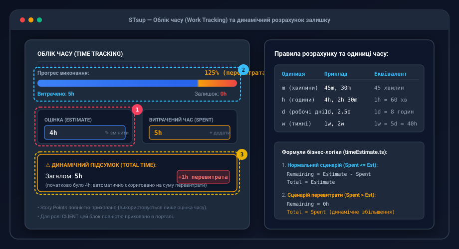

#### Правила вводу часових інтервалів:
Система оснащена лексичним парсером рядків часу, що підтримує латинські скорочення:
* `m` — хвилини (Minutes, наприклад `30m`)
* `h` — години (Hours, де $1\text{h} = 60\text{m}$)
* `d` — робочі дні (Days, де $1\text{d} = 8\text{h}$)
* `w` — робочі тижні (Weeks, де $1\text{w} = 5\text{d} = 40\text{h}$)
* Дозволено комбінований формат: `1w 2d 4h 30m`.

#### Математична модель динамічного розрахунку:
Нехай $E$ — первинна оцінка (Original Estimate), $L$ — фактично залогований час (Logged Work), а $R$ — залишок часу (Remaining Time).

1. **Штатний режим (робота в межах оцінки, $L \le E$):**
   $$R = E - L$$
   $$\text{Загальний розрахунковий час} = E$$
   *Колір прогрес-бару*: Синій/Зелений.

2. **Режим перевитрати часу (Overtime, $L > E$):**
   $$R = 0$$
   $$\text{Загальний розрахунковий час} = L$$
   *Колір прогрес-бару*: Червоний/Бурштиновий. Значення «Загалом» автоматично збільшується до фактично витраченого часу, інформуючи керівника про вихід за межі бюджету без втрати історичної первинної оцінки ❶.

---

### 2.4. Швидка дія «Повернути до клієнта» (Handoff Workflow)

Під час діагностики складної технічної проблеми інженеру часто потрібно уточнити деталі у клієнта або запросити додаткові права доступу. Для цього реалізовано дію в 1 клік — кнопку **«Повернути до клієнта»**.

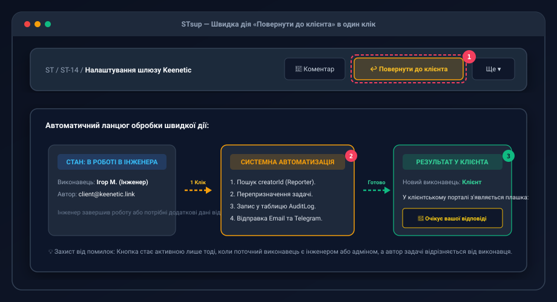

#### Послідовність виконання дії:
1. Інженер перебуває в картці задачі зі статусом `IN_PROGRESS`.
2. У верхньому блоці швидких дій натискає помаранчеву кнопку **«Повернути до клієнта»** ❶.
3. Система виконує комплексне атомарне оновлення задачі в базі даних:
   * Поле `status` автоматично перемикається на `AWAITING_CLIENT`.
   * Поле `assigneeId` встановлюється рівним `reporterId` (завдання призначається на клієнта, який створив звернення) ❷.
   * У системному журналі дій фіксується подія передачі.
   * Надійно надсилається повідомлення в Telegram-канал та електронною поштою автору задачі.
4. На екрані клієнта у порталі з'являється яскравий індикатор готовності до відповіді.

---

### 2.5. Аудит та історія змін (Activity & Audit Log)

Кожна операція в картці задачі незворотно протоколюється в хронологічному аудиторському журналі.

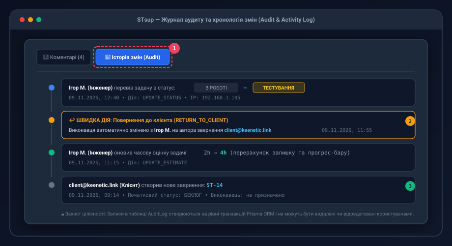

#### Властивості аудит-логу:
* **Незмінність (Immutability)**: Записи історії не підлягають редагуванню чи видаленню користувачами.
* **Деталізація полів**: Для кожної події відображається точний час, аватар і повне ім'я ініціатора, модифіковане поле, а також старе та нове значення ❶ (наприклад, `Статус: [В роботі] ➔ [Тестування]`).
* **Системні події**: Автоматично позначаються міткою `System Event` (наприклад, перерахунок залишку часу, імпорт із бекапу).

---

### Блок для NotebookLM: Скрипт подкасту та FAQ Модуля 2

#### 🎙 Сценарій диктора для аудіоогляду:
> **Ведучий 1**: «Мене завжди дратувало в старих системах, коли щоб поміняти статус задачі, треба відкрити вікно редагування, прокрутити вниз, вибрати зі списку і ще натиснути кнопку "Зберегти".»  
> **Ведучий 2**: «В STsup це вирішено ідеально. Прямо в правому сайдбарі є компактний статус-бейдж. Натиснув — випав список: Беклог, В роботі, Очікує клієнта, Тестування, Готово. Один клік — і статус миттєво змінився! А кольори підібрані так, що навіть периферійним зором зрозуміло, що відбувається із задачею.»  
> **Ведучий 1**: «А що буде, якщо задача зайняла більше часу, ніж оцінювали на старті?»  
> **Ведучий 2**: «Система не заблокує вас і не зламає графік. Вона розумно переведе індикатор залишку в нуль, а загальний час автоматично збільшить відповідно до реальних витрат, підсвітивши смужку попереджувальним кольором. Прозорість на всі сто відсотків!»

#### ❓ Часті запитання (FAQ):
* **П: Чи можу я вказати оцінку задачі одночасно в днях і годинах?**  
  *В: Так. Формат `2d 4h` коректно розпізнається системою як 20 робочих годин (за стандартом 8-годинного робочого дня).*
* **П: Чи бачить клієнт внутрішні коментарі та історію оцінки часу?**  
  *В: Ні. Всі часові журнали та технічні аудит-мітки є закритими для перегляду з клієнтського порталу.*

---

## МОДУЛЬ 3. Клієнтський портал (/portal) та двостороння взаємодія

Клієнтський портал (`/portal`) — це спеціалізоване, безпечне робоче середовище для представників компаній-замовників, розроблене для простого й прозорого сервісного обслуговування.

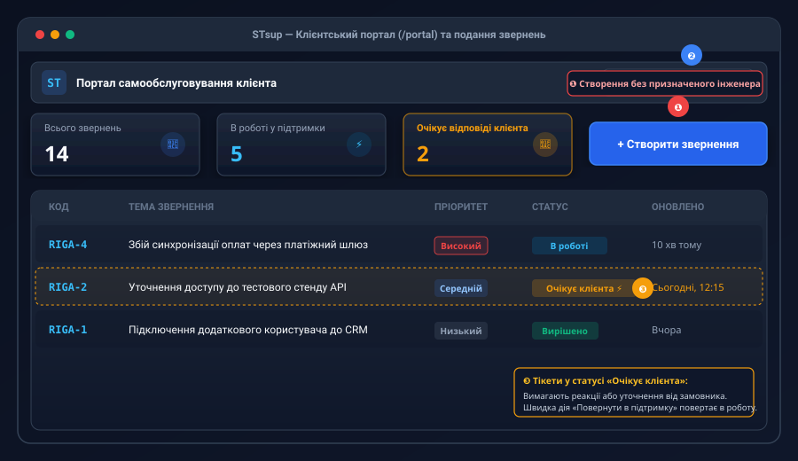

### 3.1. Ізоляція даних та права доступу клієнта

1. **Мультитенентність на рівні організації**:
   * Користувач із роллю `CLIENT` прив'язаний до своєї компанії (Organization).
   * Він має доступ до перегляду виключно тих звернень, які належать його організації. Доступ до проєктів та тікетів інших клієнтів суворо ізольований на рівні SQL-запитів бази даних.
2. **Права на редагування атрибутів**:
   * Клієнт має право самостійно редагувати: **Тему звернення (Summary)**, **Детальний опис проблеми (Description)** та **Бажаний пріоритет (Priority)**.
   * Клієнт не має можливості призначати внутрішніх інженерів, переглядати системний беклог, видаляти звернення або змінювати системні компоненти.

---

### 3.2. Подання нового звернення (Unassigned Ticket Creation)

Коли представник замовника натискає кнопку **«+ Створити звернення»** ❶:
* Відкривається спрощена форма: Тема, Опис проблеми, Вибір категорії сервісу, Пріоритет.
* **Принцип нульового призначення**: Поле «Виконавець» (Assignee) відсутнє у формі. Нове звернення створюється **без призначеного інженера** (`Assignee = null`) та набуває статусу `BACKLOG` або потрапляє в чергу первинного Тріажу (Triage).
* Черговий диспетчер або лід команди підтримки бачить нерозподілене завдання у глобальному реєстрі `/projects/all` та призначає профільного інженера.

---

### 3.3. Двосторонній процес передачі: кнопка «Повернути в підтримку»

В системі реалізовано замкнений цикл комунікації між інженером та клієнтом, що виключає «зависання» звернень.

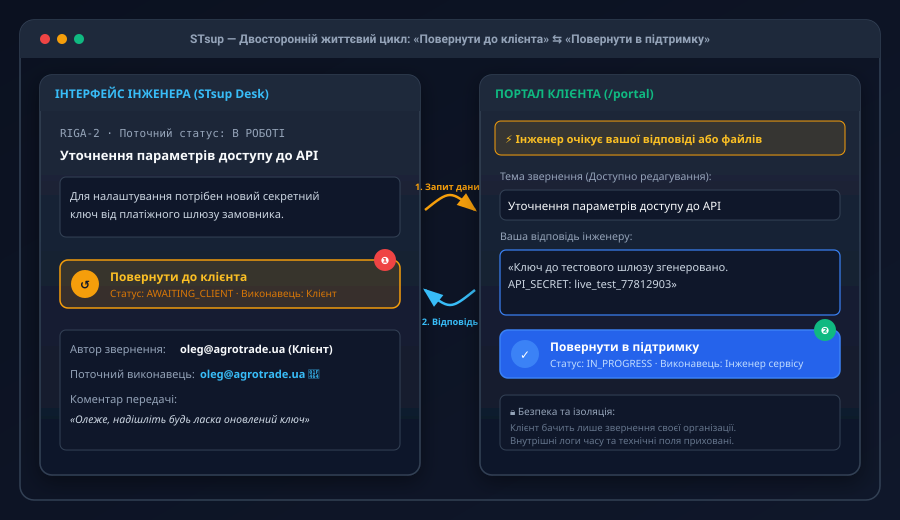

#### Сценарій повернення звернення в роботу:
1. **Інженер передав тікет клієнту**: Завдання перейшло в статус `AWAITING_CLIENT`, а його виконавцем став автор-клієнт.
2. **Клієнт відкриває портал**: У таблиці звернення підсвічується спеціальним індикатором «Очікує вашої відповіді» ❸.
3. **Клієнт вносить інформацію**: Замовник пише коментар з уточненнями, додає конфігураційні дані або прикріплює скріншоти ❷.
4. **Клієнт натискає «Повернути в підтримку»**:
   * Статус звернення автоматично змінюється на `IN_PROGRESS`.
   * Завдання перепризначається назад на сервісну команду / інженера, який вів цю задачу.
   * Чергові фахівці негайно отримують сповіщення: *«Клієнт ТОВ "АгроТрейд" надав відповідь по задачі RIGA-2»*.

---

### Блок для NotebookLM: Скрипт подкасту та FAQ Модуля 3

#### 🎙 Сценарій диктора для аудіоогляду:
> **Ведучий 1**: «А чи не заплутається клієнт у складних технічних таблицях, коли зайде на портал?»  
> **Ведучий 2**: «У жодному разі. Клієнтський портал у STsup — це зразок мінімалізму. Клієнт бачить три прості плашки: скільки всього звернень, скільки в роботі і чи є задачі, де підтримка чекає на його відповідь. Жодних незрозумілих термінів!»  
> **Ведучий 1**: «І як працює повернення задачі, коли клієнт відповів?»  
> **Ведучий 2**: «Надзвичайно зручно. Клієнт бачить велику помітну кнопку "Повернути в підтримку". Одне натискання — і статус автоматично стає "В роботі", а інженер одразу отримує повідомлення у Telegram, що відповідь надійшла. Це повністю виключає ситуації, коли задача губиться у поштовому листуванні.»

#### ❓ Часті запитання (FAQ):
* **П: Чи може клієнт призначити задачу на конкретного інженера при створенні?**  
  *В: Ні. Клієнти не керують внутрішнім штатним розкладом підтримки. Задача завжди створюється без виконавця і розподіляється внутрішнім диспетчером.*
* **П: Що бачить інженер, коли клієнт натискає «Повернути в підтримку»?**  
  *В: Картка задачі автоматично повертається у статус «В роботі», виконавець перемикається на інженера, а в аудиті додається відповідний запис.*

---

## МОДУЛЬ 4. Дошки та реєстри: Крос-проєктний Kanban і Беклог

### 4.1. Крос-проєктна Kanban-дошка (/boards) та надійна механіка Drag-and-Drop

Kanban-дошка дозволяє керувати робочим потоком компанії за принципом візуалізації «тягнучої» системи.

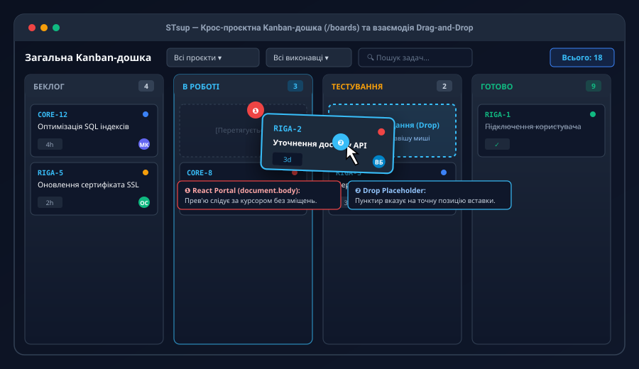

#### Архітектура колонок дошки:
1. **Беклог (Backlog)**: Завдання, відібрані до виконання, але робота над якими ще не стартувала.
2. **В роботі (In Progress)**: Активні завдання, над якими просто зараз працюють спеціалісти.
3. **Тестування (Testing)**: Етап валідації, QA або перевірки замовником.
4. **Готово (Done)**: Повністю вирішені й закриті тікети.

#### Виправлення зміщення прев'ю та робота React Portal (W3C Containing Block Fix):
* **Технічна особливість**: У ранніх версіях використання CSS-властивості `backdrop-filter: blur(...)` на заголовках створювало новий локальний контейнер координат (Containing Block) згідно зі специфікацією W3C. Через це перетягувані елементи з позиціонуванням `fixed` могли відриватися від курсора або зникати в колонці «Готово».
* **Архітектурне рішення версії v0.4.4+**:
  1. Візуальний дублікат картки (Drag Preview) рендериться безпосередньо в корінь сторінки через `createPortal(cardElement, document.body)` ❶.
  2. Завдяки цьому картка завжди ідеально супроводжує курсор миші з апаратним прискоренням `transform`.
  3. У цільовій колонці динамічно відображається напівпрозорий пунктирний слот — **Drop Placeholder** ❷, який показує точне майбутнє положення картки перед відпусканням кнопки миші.

---

### 4.2. Реєстр беклогу проєкту (?section=backlog)

Для детального планування та пріоритизації масштабних релізів використовується спеціалізований реєстр беклогу, доступний за посиланням `/projects/{id}?section=backlog`.

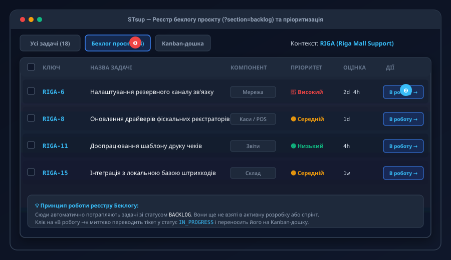

#### Ключові бізнес-правила беклогу:
* **Сувора ізоляція статусів**: У цьому розділі відображаються **виключно** задачі зі статусом `BACKLOG` ❶. Будь-які задачі зі статусами `IN_PROGRESS`, `TESTING` або `DONE` автоматично фільтруються та не перевантажують список.
* **Швидкий перехід у роботу (1-Click Push to Sprint)**: Кожен рядок таблиці беклогу оснащений кнопкою швидкої дії **«В роботу →»** ❷. Натискання цієї кнопки миттєво переводить задачу у статус `IN_PROGRESS` та робить її доступною на Kanban-дошці.
* **Агрегація оцінок**: У шапці реєстру виводиться сумарна оцінка трудовитрат усіх запланованих у беклозі задач, що допомагає оцінити обсяг майбутніх релізів.

---

### Блок для NotebookLM: Скрипт подкасту та FAQ Модуля 4

#### 🎙 Сценарій диктора для аудіоогляду:
> **Ведучий 1**: «Як на практиці виглядає робота з великою кількістю проєктів на одній дошці?»  
> **Ведучий 2**: «На Kanban-дошці STsup інженер може застосувати фільтр за проєктом або виконавцем за пів секунди. Але найголовніше — це плавність перетягування карток. Завдяки оновленню ядра до версії v0.4.4 картка задачі під час захоплення мишею буквально "прилипає" до курсора через спеціальний React-портал, а місце скидання чітко підсвічується пунктиром. Жодних збоїв чи затримок!»  
> **Ведучий 1**: «А навіщо тоді взагалі окремий реєстр беклогу?»  
> **Ведучий 2**: «Беклог — це інструмент для спокійного планування. Коли у вас сотня ідей чи майбутніх завдань, тримати їх на активній дошці — це хаос. У беклозі вони акуратно згруповані за пріоритетами, і тільки коли ви готові почати роботу — натискаєте "В роботу", і задача з'являється на дошці.»

#### ❓ Часті запитання (FAQ):
* **П: Чому перетягнута в колонку «Готово» задача більше не відображається в Беклозі?**  
  *В: Реєстр беклогу строго фільтрує задачі зі статусом `BACKLOG`. Як тільки статус змінюється на будь-який інший, задача переходить у відповідні робочі списки та дошки.*
* **П: Чи можна налаштувати права перетягування карток для окремих співробітників?**  
  *В: Так, зміна статусів доступна ролям `ADMIN` та `ENGINEER`. Клієнти не мають доступу до загальної інженерної дошки.*

---

## МОДУЛЬ 5. Адміністрування, інтеграції та резервне копіювання

Розділ системних налаштувань (`/settings`) призначений для користувачів із роллю `ADMIN` і забезпечує комплексне керування зв'язком та збереженням даних.

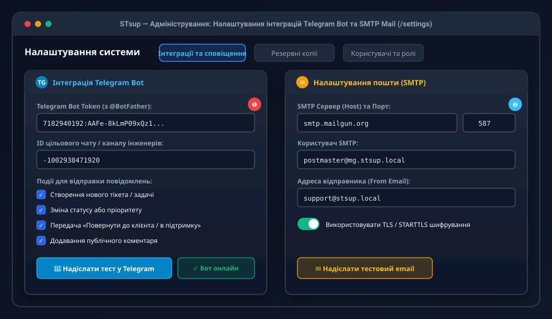

### 5.1. Налаштування сповіщень у Telegram

Інтеграція дозволяє миттєво інформувати інженерів у черговому чаті про критичні події.

#### Параметри підключення:
* **Bot Token** ❶: Унікальний токен бота, отриманий через офіційного `@BotFather` у Telegram.
* **Target Chat ID**: Числовий ідентифікатор групи, супергрупи або каналу (для приватних каналів підтримки зазвичай починається з `-100...`).
* **Матриця подій (Event Toggles)**:
  * `[x]` Створення нового тікета
  * `[x]` Зміна статусу або пріоритету
  * `[x]` Дії передачі «Повернути до клієнта / в підтримку»
  * `[x]` Додавання публічних коментарів
* **Кнопка тестування**: Натискання «🚀 Надіслати тест у Telegram» виконує тестовий виклик Telegram Bot API та сигналізує зеленим бейджем «✓ Бот онлайн» про успішну доставку.

---

### 5.2. Конфігурація поштового шлюзу (SMTP Mail)

Для відправки email-сповіщень клієнтам використовується стандартний SMTP-клієнт.

* **Параметри конфігурації** ❷:
  * `Host`: Адреса SMTP-сервера (наприклад, `smtp.mailgun.org`, `smtp.office365.com`, `smtp.gmail.com`).
  * `Port`: Порт з'єднання (`587` для TLS/STARTTLS або `465` для SSL).
  * `User / Password`: Реквізити аутентифікації.
  * `From Email Address`: Офіційна адреса відправника (наприклад, `support@company.com`).
  * `Test Email`: Відправка тестового повідомлення на адресу адміністратора для перевірки handshake-з'єднання.

---

### 5.3. Резервне копіювання (.stsup) та регламент безпечного відновлення

STsup забезпечує повну автономність збереження даних без прив'язки до зовнішніх хмарних провайдерів.

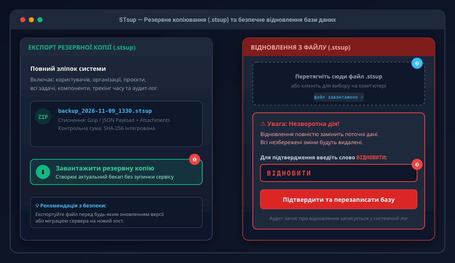

#### 1. Експорт бекапу (.stsup):
* Адміністратор переходить у вкладку «Резервні копії» та натискає кнопку **«Завантажити резервну копію»** ❶.
* Серверний бекенд створює консистентний знімок (Snapshot) реляційної бази даних, формує маніфест цілісності, запаковує структури у стиснений Gzip-архів формату `.stsup` та передає браузеру на завантаження. Операція виконується у фоновому режимі без блокування читання чи запису в систему.

#### 2. Регламент безпечного відновлення бази (Safety Protocol):
Оскільки відновлення бази даних є критичною незворотною операцією, яка перезаписує всі поточні записи, система захищена спеціальним протоколом підтвердження:
1. Адміністратор завантажує файл `.stsup` у зону Drag-and-Drop ❷.
2. Система перевіряє сигнатуру архіву, версію схеми та контрольні суми.
3. **Модальне вікно захисту (Hazard Modal)** ❸:
   * Кнопка запуску відновлення залишається заблокованою (`disabled`).
   * Щоб розблокувати дію, адміністратор зобов'язаний вручну ввести кодове слово-підтвердження у верхньому регістрі: **`ВІДНОВИТИ`**.
   * Тільки після повного співпадіння рядка стає активною червона кнопка «Підтвердити та перезаписати базу».
4. Після завершення операції всі активні сесії скидаються, а в аудит-лог заноситься системний запис про дату, час та ініціатора процедури відновлення.

---

### Блок для NotebookLM: Скрипт подкасту та FAQ Модуля 5

#### 🎙 Сценарій диктора для аудіоогляду:
> **Ведучий 1**: «Уявімо найгірший сценарій: збій на сервері чи випадкова помилка налаштування. Наскільки складно відновити роботу STsup?»  
> **Ведучий 2**: «Це робиться у кілька кліків, але із залізобетонним захистом від дурня. Адміністратор бере збережений файл із розширенням крапка-stsup — до речі, це компактний зашифрований gzip-архів з усіма даними — і перетягує його у вікно відновлення. Але щоб ніхто випадково не перезаписав робочу базу, система вимагає надрукувати слово "ВІДНОВИТИ" великими літерами. Без цього кнопка просто не спрацює!»  
> **Ведучий 1**: «А як щодо оперативних сповіщень команди про нові інциденти?»  
> **Ведучий 2**: «Тут є штатна інтеграція з Telegram. Ввели токен від BotFather, вказали ID робочого каналу інженерів, обрали галочками потрібні події — і все! Кожен новий тікет або зміна пріоритету миттєво летить у чат чергової зміни.»

#### ❓ Часті запитання (FAQ):
* **П: Чи переривається робота користувачів під час створення бекапу?**  
  *В: Ні. Експорт бекапу здійснюється асинхронно через транзакційний знімок, користувачі продовжують безперешкодно працювати.*
* **П: Що трапиться, якщо ввести слово «відновити» малими літерами?**  
  *В: Валідатор модального вікна вимагає точного збігу у верхньому регістрі — `ВІДНОВИТИ`. При введенні малими літерами кнопка залишиться заблокованою.*

---

## МОДУЛЬ 6. Зведений довідник та чеклист впровадження

### 6.1. Швидка шпаргалка гарячих клавіш та дій

| Дія | Де виконується | Гарячі клавіші / Метод |
| :--- | :--- | :--- |
| **Глобальний пошук задач** | Будь-який екран | `Ctrl + K` або `Cmd + K` |
| **Швидке створення задачі** | Будь-який екран | Синя кнопка у верхньому меню `+ Створити` |
| **Копіювання посилання на задачу** | Картка задачі | Клік по коду `PROJECT-ID` або іконці ланцюжка |
| **Передача задачі клієнту** | Картка задачі | Кнопка «Повернути до клієнта» у верхній панелі дій |
| **Повернення задачі в підтримку** | Клієнтський портал | Кнопка «Повернути в підтримку» у картці звернення |
| **Переміщення статусу задачі** | Kanban-дошка | Перетягування (Drag-and-Drop) або Dropdown Badge |

---

### 6.2. Регламентний чеклист запуску нового клієнта в системі:
- [x] **Крок 1**: Створити Організацію клієнта в налаштуваннях (`/settings`).
- [x] **Крок 2**: Створити Проєкт із власним унікальним ключем (наприклад, `RIGA` або `AGRO`).
- [x] **Крок 3**: Зареєструвати контактну особу замовника з роллю `CLIENT` та прив'язати її до організації.
- [x] **Крок 4**: Перевірити відправку тестового сповіщення в Telegram-канал чергової зміни інженерів.
- [x] **Крок 5**: Надати клієнту посилання на портал самообслуговування `https://<домен>/portal`.
- [x] **Крок 6**: Створити перший тестовий бекап конфігурації у форматі `.stsup`.

---
*Документація підготовлена та згенерована автоматично для використання у складі інтелектуальних баз знань, корпоративних асистентів та інструментів генеративного навчання.*
